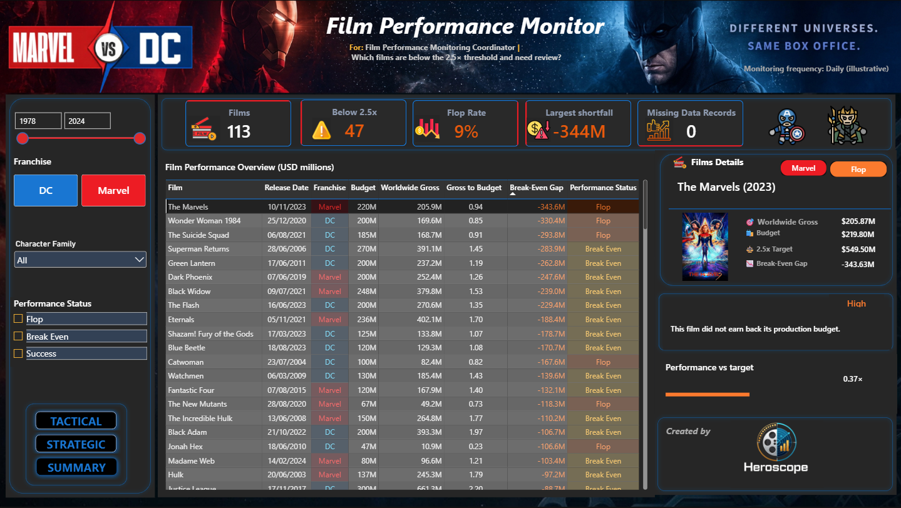
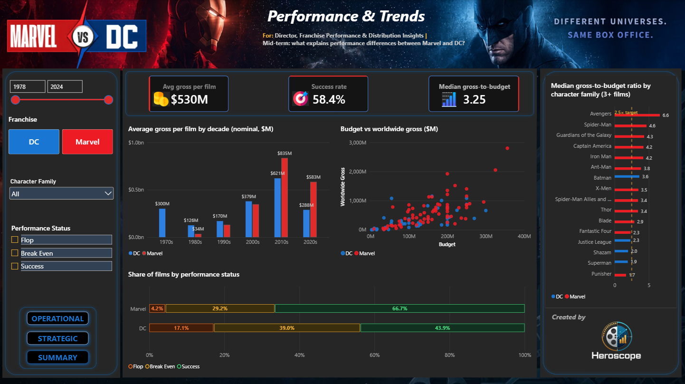
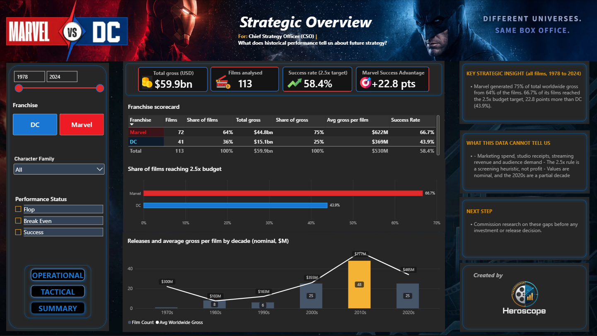
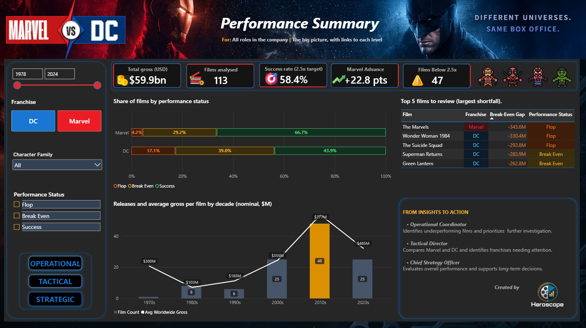

# Marvel vs DC: Who Wins the Box Office?

**One dataset, three levels of decisions.**

A Power BI report that analyses 113 Marvel and DC films (1978–2024), with one page per level of the information pyramid: operational, tactical and strategic, plus a summary page for everyone. Built by Team Heroscope at Nackademin (BI26).


---

## Overview

We imagined a film-performance advisory company where different people need different answers from the same data:

| Level | Audience | Business question |
|---|---|---|
| **Operational** | Film Performance Monitoring Coordinator | Which films need review, and why? |
| **Tactical** | Director, Franchise Performance & Distribution Insights | What explains the performance differences between Marvel and DC? |
| **Strategic** | Chief Strategy Officer | What does historical performance tell us about future strategy? |
| **Summary** | Everyone in the company | Where do we stand, and where do I go for detail? |

The principle: **the right data to the right person at the right time in the right format.** Navigation buttons let users move between the levels, and every number on the summary page can be traced down to individual films.

### One rule for every page

Each film is classified by **gross-to-budget ratio** (worldwide gross ÷ production budget):

| Status | Rule | Meaning |
|---|---|---|
| **Success** | 2.5× or more | Gross is at least 2.5 times the budget |
| **Break even** | 1.0× to 2.5× | Covers its budget but misses the target |
| **Flop** | Below 1.0× | Does not cover its budget |

The 2.5× rule is a box-office rule of thumb, not a measure of profit.

---

## Dashboards

### Operational: film performance monitor



A film-level table sorted by break-even gap, so the coordinator can see exactly which films to review first, with a detail card for the selected film.

### Tactical: franchise performance and trends



Average gross per film by decade, budget vs worldwide gross, and the median gross-to-budget ratio by character family.

### Strategic: overview for the Chief Strategy Officer



A franchise scorecard, the share of films reaching the 2.5× target, and an honest list of what the data cannot tell us.

### Summary: dashboard for everyone



Total gross of **$59.9bn** across 113 films, a **58.4%** success rate, and the top five films furthest below their target.

---

## Key findings

- **Marvel earned 75% of the total gross from 64% of the films.**
- **Marvel reaches the 2.5× target more often:** 66.7% of its films versus 43.9% for DC, a lead of 22.8 percentage points.
- **Marvel earns more per film:** $622M on average versus $369M for DC.
- **DC has more flops:** 17.1% of DC films do not cover their budget, compared with 4.2% for Marvel.
- **47 of 113 films are below the 2.5× target.** The largest shortfall is *The Marvels* (2023), at −$344M.
- **The 2010s were the peak decade,** with 48 films and about $777M average gross per film. Most of Marvel's lead comes from the 2010s and 2020s.
- **11 of 16 character families clear the 2.5× line** (families with at least three films).

---

## Data quality

- **Inflation check:** the inflation-adjusted chart showed no change at all for Marvel. A validation check confirmed that the adjusted values only existed for DC films, so we left those columns out of the whole report. All values are nominal.
- **Completeness:** 0 films with missing financial data.

---

## What the data cannot tell us

- Marketing spend
- Studio receipts (worldwide gross is not studio revenue, and not profit)
- Streaming revenue
- Audience demand

The 2020s are a partial decade. **Next step:** research these gaps before any investment or release decision.

---

## Data

| Dataset | Coverage |
|---|---|
| [Box office of DC and Marvel superhero movies](https://www.kaggle.com/datasets/mdtoomey/box-office-of-dc-and-marvel-superhero-movies) (Kaggle) | 113 films (72 Marvel, 41 DC), release years 1978–2024 |

---

## Tools and methods

- **Power Query:** data cleaning and preparation
- **DAX:** KPI measures such as success rate, gross-to-budget ratio, break-even gap and franchise advantage
- **Power BI report design:** four report pages for different audiences, shared slicers (year range, franchise, character family, performance status), page navigation and consistent colours for each franchise and status

---

## Repository structure

```
marvel-vs-dc-powerbi/
├── README.md
└── images/
    ├── 01-operational.png
    ├── 02-tactical.png
    ├── 03-strategic.png
    └── 04-summary.png
```

---

## Team Heroscope

Group project in the course *Datavisualisering*, Business Intelligence Analyst programme (BI26), Nackademin, 2026. We presented the report to our class with a live demo in Power BI.

- Chayanis Karlsson ([LinkedIn](https://www.linkedin.com/in/chayanis-k))
- Poonam Tolambiya
- Rabbiya Yasir
- Rekha Khatri

---

## About this project

This is a student project, created for educational purposes as part of the Business Intelligence Analyst programme at Nackademin. It is not affiliated with or endorsed by Marvel, DC or their owners. Film titles, logos and character images are used only to identify the subject of the analysis.
